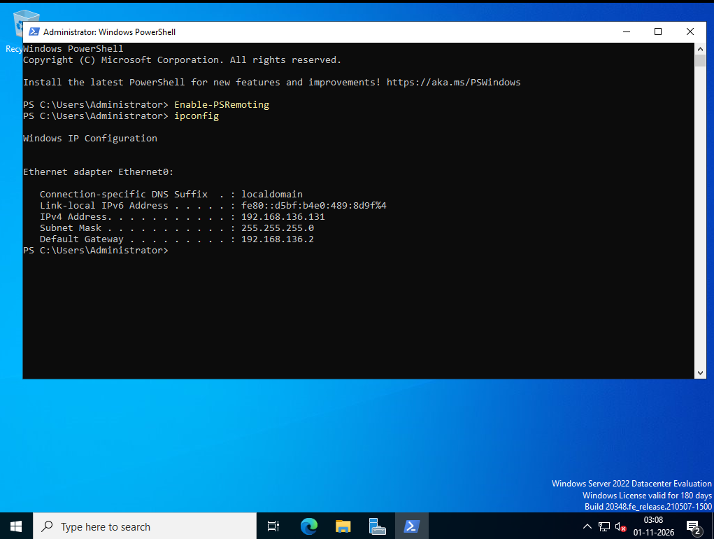
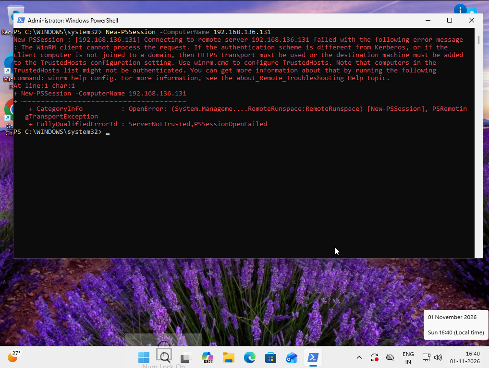
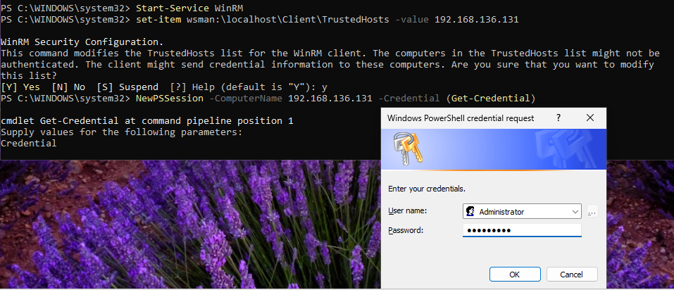
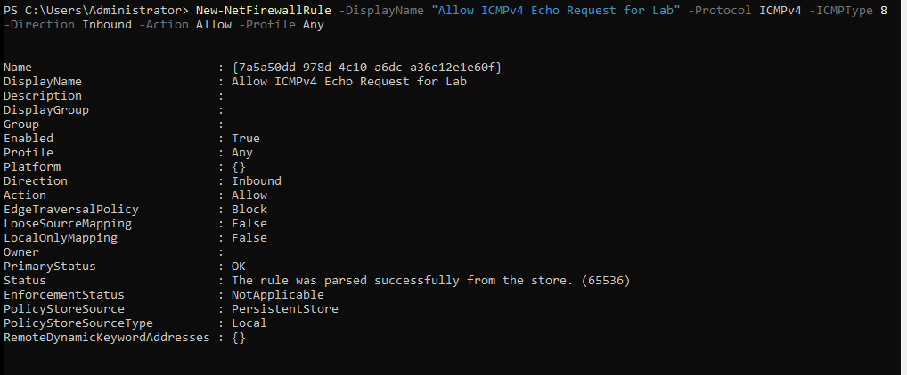
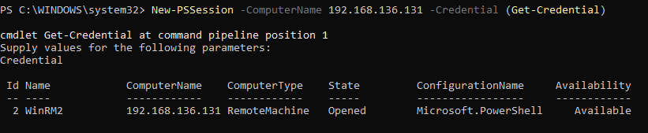
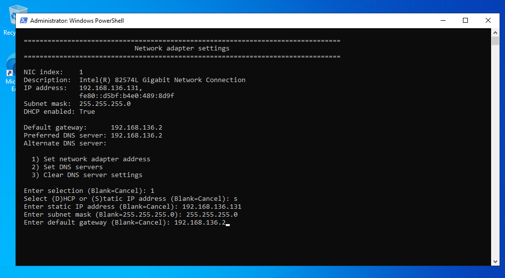
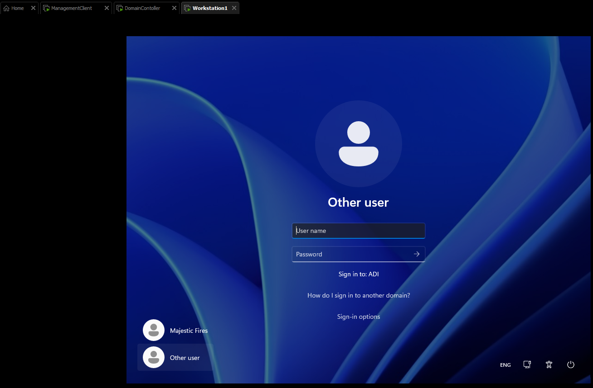

# Active Directory Lab Setup - Windows Server 2022 and Windows 11

Step by step Proof of Concept (PoC) for building an Active Directory (AD) lab using Windows Server 2022 Evaluation Edition as the Domain Controller (DC) and Windows 11 machines as the Management Console (MC) and Workstation (WS).

This lab covers:
- Enabling PowerShell Remoting using WinRM.
- Configuring network connectivity between the MC and DC.
- Promoting Windows Server to a Domain Controller.
- Configuring static IP addresses and DNS.
- Joining a Windows 11 workstation to the AD domain.

## Lab Environment

| Machine | Operating System | Role |
|---|---|---|
| DC | Windows Server 2022 Evaluation Edition | Domain Controller |
| MC | Windows 11 | Management Console |
| WS | Windows 11 | Domain-joined Workstation |

## Command Conventions

- `DC:` Commands run on the Domain Controller.
- `MC:` Commands run on the Management Console.
- `WS:` Commands run on the Workstation.
- `ps:` PowerShell command. Commands run as Administrator unless stated otherwise.
- `cmd:` Command Prompt command.
- `IP` is a placeholder for the actual IP address of the DC which we set.

---

## 1. Enable PowerShell Remoting

Before configuring Active Directory, we need remote administrative access to the Domain Controller from the Management Console.

### 1.1 Enable WinRM on the DC

DC (ps):

```powershell
Enable-PSRemoting
```

This enables PowerShell Remoting by configuring WinRM, registering session configurations, and setting up firewall exceptions where applicable. The command may complete without displaying a success message.

Next, identify the DC's current network configuration.

DC (cmd):

```cmd
ipconfig
```

This displays the IP address and basic network settings required to connect to the DC remotely.



### 1.2 Attempt a remote session from the MC

MC (ps admin):

```powershell
New-PSSession -ComputerName IP
```

This attempts to create a remote PowerShell session with the DC. It may fail because the MC does not yet trust the remote computer.



### 1.3 Configure WinRM and TrustedHosts

MC (ps admin):

```powershell
Start-Service WinRM
```

This starts the WinRM service on the MC, which is required for PowerShell Remoting.

MC (ps admin):

```powershell
Set-Item WSMan:\localhost\Client\TrustedHosts -Value IP
```

This adds the DC's IP address to the MC's TrustedHosts list. In a workgroup environment, this can allow connections to remote computers using IP addresses when domain-based authentication is unavailable.

When prompted, enter:

```text
Y
```

Now establish the remote session using explicit credentials.

MC (ps admin):

```powershell
New-PSSession -ComputerName IP -Credential (Get-Credential)
```

This creates a remote session and prompts for credentials to authenticate against the DC.



**Security note:** TrustedHosts does not verify the remote server's identity. Use it only in a controlled lab. For production environments, prefer domain-based authentication or properly configured HTTPS.

### 1.4 Troubleshoot network connectivity

If WinRM still fails, verify that the MC and DC are connected to compatible virtual network settings. In this lab, both machines must be able to communicate over the same virtual network.

On the DC, allow inbound ICMPv4 Echo Requests for troubleshooting.

DC (ps admin):

```powershell
New-NetFirewallRule -DisplayName "Allow ICMPv4 Echo Request for Lab" -Protocol ICMPv4 -IcmpType 8 -Direction Inbound -Action Allow -Profile Any
```

This creates a firewall rule allowing incoming IPv4 ping requests. It helps verify network reachability but does not enable WinRM itself.



### 1.5 Verify WinRM and establish the session

MC (ps):

```powershell
Test-WSMan IP
```

This checks whether the DC's WinRM service is responding to requests from the MC.

MC (ps admin):

```powershell
New-PSSession -ComputerName IP -Credential (Get-Credential)
```

This creates a new authenticated remote session after network connectivity and WinRM have been configured.



Enter the credentials when prompted.

To interactively enter the remote session, use the session ID returned by `New-PSSession`. For example, if the session ID is `2`:

MC (ps):

```powershell
Enter-PSSession 2
```

This connects your PowerShell prompt to the remote DC, allowing commands to execute on the server.

---

## 2. Configure the Domain Controller

### 2.1 Change the hostname

A Windows Server installation may have an automatically generated hostname. Change it to a recognizable name before promoting the server to a Domain Controller.

DC (ps):

```powershell
sconfig
```

This opens the Server Configuration menu. Select the option to change the computer name and enter your preferred hostname.

Restart if prompted.

### 2.2 Configure a static IP address

First, inspect the existing network configuration.

DC (cmd):

```cmd
ipconfig /all
```

This displays the IP address, subnet mask, gateway, DNS configuration, and adapter details.

In my lab, the initial configuration was:

| Setting | Value |
|---|---|
| IPv4 address | 192.168.136.131 |
| Subnet mask | 255.255.255.0 |
| Default gateway | 192.168.136.2 |

A Domain Controller should have a stable IP address because domain clients rely on it to locate DNS and AD services.

Open the Server Configuration menu.

DC (ps):

```powershell
sconfig
```

Navigate through the following options:

1. Select `8` for Network Settings.
2. Select `1` for the network adapter.
3. Select `1` to set the network adapter address.
4. Select `S` for Static.
5. Enter `192.168.136.131` as the IP address.
6. Enter `255.255.255.0` as the subnet mask.
7. Enter `192.168.136.2` as the default gateway.



The IP address above is specific to my lab. Use the appropriate address for your own virtual network.

### 2.3 Configure DNS on the DC

An AD Domain Controller should use its own DNS service to resolve domain records.

Open the Server Configuration menu.

DC (ps):

```powershell
sconfig
```

Navigate through:

1. Select `8` for Network Settings.
2. Select `1` for the network adapter.
3. Select `2` to set DNS servers.
4. Set the preferred DNS server to `192.168.136.131`.
5. Leave the alternate DNS server blank.

After changing network settings, create a fresh PowerShell remote session if the existing one disconnects or becomes unreliable.

---

## 3. Install Active Directory Domain Services

### 3.1 Install the AD DS role

Run the following command on the DC, either locally or through the connected remote session.

DC (ps admin):

```powershell
Install-WindowsFeature AD-Domain-Services -IncludeManagementTools
```

This installs the Active Directory Domain Services role and its management tools, preparing the server for domain controller deployment.

### 3.2 Promote the server to a Domain Controller

Import the AD DS deployment module.

DC (ps admin):

```powershell
Import-Module ADDSDeployment
```

This loads the PowerShell commands required to deploy and configure AD DS.

Start the forest installation.

DC (ps admin):

```powershell
Install-ADDSForest
```

This creates a new AD forest and domain. Follow the prompts to:

- Specify the domain name as `Adi.com`.
- Configure the Directory Services Restore Mode (DSRM) password.
- Confirm the installation settings.

The installation can take several minutes. The server will automatically restart after promotion.

---

## 4. Configure DNS on the Domain Controller and Workstation

### 4.1 Verify DNS configuration on the DC

After the DC restarts, inspect its DNS client configuration.

DC (ps admin):

```powershell
Get-DnsClientServerAddress
```

This displays the DNS servers configured for each network interface. Identify the interface index for Ethernet0. In my lab, it is `13`.

Set the DNS server address to the DC's static IP.

DC (ps admin):

```powershell
Set-DnsClientServerAddress -InterfaceIndex 13 -ServerAddresses 192.168.136.131
```

This configures the selected network interface to use the DC's own DNS service.

### 4.2 Configure DNS on the WS

On the Windows 11 workstation, inspect the DNS configuration.

WS (ps admin):

```powershell
Get-DnsClientServerAddress
```

This identifies the DNS servers and interface indices configured on the workstation.

Identify the interface index for Ethernet0. In my lab, it is also `13`.

Configure the workstation to use the DC as its DNS server.

WS (ps admin):

```powershell
Set-DnsClientServerAddress -InterfaceIndex 13 -ServerAddresses 192.168.136.131
```

This directs the workstation's DNS queries to the DC, allowing it to resolve AD domain records.

**Important:** Interface indices are machine-specific. Verify the correct index on your own workstation before running the command.

---

## 5. Join the Windows 11 Workstation to the Domain

On the WS, open PowerShell as Administrator and execute:

WS (ps admin):

```powershell
Add-Computer -DomainName Adi.com -Credential Adi\Administrator -Force -Restart
```

This command joins the workstation to the `Adi.com` domain.

- `-DomainName` specifies the target domain.
- `-Credential` specifies the domain account used for authentication.
- `-Force` suppresses confirmation prompts.
- `-Restart` reboots the workstation to complete the domain join.

After the reboot, select **Other users** on the Windows login screen.



Sign in using a domain account, for example:

```text
Adi\Administrator
```

The workstation is now joined to the Active Directory domain.

---

## 6. Final Verification

### Verify domain membership

WS (ps):

```powershell
Get-CimInstance Win32_ComputerSystem | Select-Object Name, Domain, PartOfDomain
```

This retrieves the workstation's computer-system information and confirms whether it is joined to a domain.

Expected result: `PartOfDomain` should be `True`, and `Domain` should be `Adi.com`.

### Verify Domain Controller discovery

WS (ps):

```powershell
nltest /dsgetdc:Adi.com
```

This locates a Domain Controller for the specified domain and displays its information.

### Verify DNS resolution

WS (ps):

```powershell
nslookup Adi.com
```

This queries DNS for the domain name and helps confirm that the workstation is using the correct DNS server.

---

## Lab Summary

In this PoC, we established remote administration between Windows 11 and Windows Server 2022, configured stable networking and DNS, deployed a new AD forest, and joined a Windows 11 workstation to the domain.

The result is a basic Active Directory lab environment that can be extended for further learning, including Group Policy, user and group management, Kerberos authentication, and enterprise security testing.
